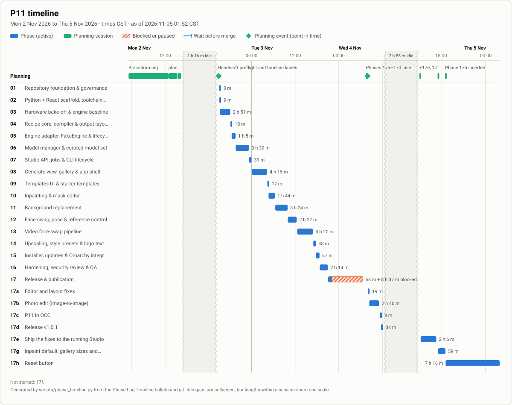
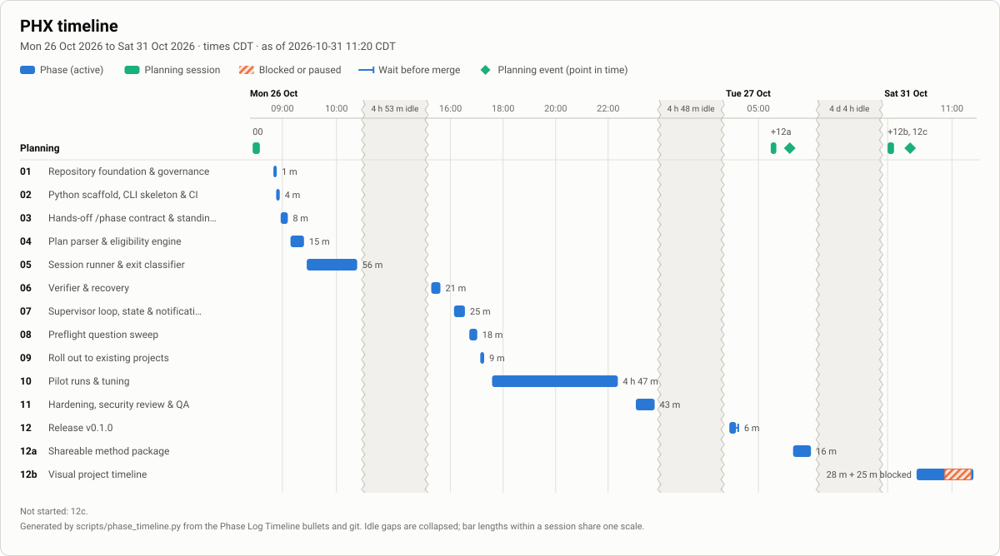

# PhaseHypervisor (`phx`)

**Plan a big build in phases, run each one in a fresh Claude Code session, and keep an accurate record and picture of what happened.**

Status: v0.1.0, public. The [final report](docs/PHX_FINAL-REPORT.md) has the definition-of-done evidence, measured results and known limitations.

## Why use it
PHX is built on the `phased-project` method: a spec, a plan of phases, and one self-contained prompt per phase, each run in its own Claude Code session on the model the plan names. You get five things out of it. The documentation, charts, timeline and security phase come from the method, so they work with manual `/phase` runs too; `phx` adds the hands-off runner and the per-run cost and token records.

### Documentation that stays accurate
Every project gets a spec with amendments, an ADR log, a plan, self-contained phase prompts, a timestamped Phase Log and, at the end, a final report. Updating them is a required step of closing a phase, so they are kept current as the work goes rather than written afterwards. [Project P11](https://github.com/antonizick/project1111) (a local image studio, built with this method) is a public example: its [plan](https://github.com/antonizick/project1111/blob/main/P11_IMPLEMENTATION_PLAN.md), [48 ADRs](https://github.com/antonizick/project1111/blob/main/docs/P11_DECISIONS.md), [phase prompts](https://github.com/antonizick/project1111/tree/main/prompts), [threat model](https://github.com/antonizick/project1111/blob/main/docs/P11_THREAT-MODEL.md) and [final report](https://github.com/antonizick/project1111/blob/main/docs/P11_FINAL-REPORT.md) are all there to read.

### Quick-reference charts
The plan's status table shows every phase's stage at a glance. This is an excerpt of P11's real table (as of 2026-11-05 01:52 CST; the [full table](https://github.com/antonizick/project1111/blob/main/P11_IMPLEMENTATION_PLAN.md) has 26 phases):

| Phase | Name | Model | Depends on | Status | Gate |
|---|---|---|---|---|---|
| 05 | Engine adapter, FakeEngine & lifecycle | Opus 5.5 | 03, 04 | ✅ Complete | auto |
| 16 | Hardening, security review & QA | Opus 5.5 | 09, 11, 13, 14, 15 | ✅ Complete | auto |
| 17 | Release & publication | Sonnet 5.5 | 16 | ✅ Complete | review |
| 17e | Ship the fixes to the running Studio | Opus 5.5 | 17d | ✅ Complete | review |
| 17f | Release v1.0.2 | Sonnet 5.5 | 17e, 17g, 17h | ⬜ Not started | review |

Stages: ⬜ not started · 🔄 in progress · ⛔ blocked · ✅ complete. Dependencies decide which phase runs next, and a Gate says whether a run may continue by itself or waits for the owner.

### The timeline
The timeline is generated from the plan's Phase Log and git, not drawn by hand. It shows planning as well as building, collapses idle time and marks blocked time. This is a snapshot of P11 as of 2026-11-05 01:52 CST, unedited ([live version](https://github.com/antonizick/project1111/blob/main/P11_IMPLEMENTATION_PLAN.md#timeline)):



What to look at:
- **Planning lane (top):** brainstorming, the plan draft, preflight and each later phase insertion, drawn on the same clock as the build.
- **Zigzag grey bands:** idle gaps (here 1 h 16 m and 2 h 56 m) squeezed out so the chart stays readable instead of stretching over days.
- **Hatched span on Phase 17:** time the phase sat blocked or paused (8 h 37 m), shown next to its 58 m of active work.
- **One bar per phase,** labelled with its active time, so a quick glance shows where the effort went.

Its summary totals: elapsed 2 d 17 h, active phase time 1 d 20 h, blocked or paused 8 h 37 m, idle 4 h 12 m in 2 gaps over 60 min.

<details>
<summary>PHX's own timeline (this project)</summary>



Regenerated whenever a phase is claimed, blocked, resumed or closed; see the plan's [Timeline](PHX_IMPLEMENTATION_PLAN.md#timeline).
</details>

### Security posture built into the plan
Every plan the method writes includes a hardening phase just before the release: a written threat model, scanners, security review and QA. The release phase depends on it, and the plan's dependencies (which `phx` enforces) keep it from starting first. Findings are recorded and resolved in the plan (as ADRs and Phase Log follow-ups) rather than left in someone's head. PHX did this for itself: see its [threat model](docs/PHX_THREAT_MODEL.md) and [SECURITY.md](SECURITY.md). Because agents may run with bypassed permissions, `phx` also stops and asks, or blocks the phase with a question in hands-off mode, before any action that looks high-risk or irreversible.

### Resource use you can measure and tune
Time is recorded for every phase and planning session: a timestamped Timeline bullet in the Phase Log, drawn on the chart above. The plan names the model for each phase, so model choice is on the record. When `phx` runs the phases, it also logs every decision with its reason to `~/.local/state/phx/<repo>/run.jsonl`, keeps tokens, cost and sessions per phase in `state.json`, and appends a run summary to your project note. After a project you can see where the hours, models, tokens and dollars went, and decide where a cheaper model or a smaller phase would have done the job.

Those records are plain JSONL and Markdown, so month-to-month and quarter-to-quarter trends in time, cost, completed phases and cost per phase are a short script away. PHX does not yet ship a trend report of its own.

> I've used this method on several projects now. The timeline is my favourite part: it shows planning and each phase of the build, including the idle gaps and the blocked stretches.
> — `antonizick`

**What `phx` adds.** The method works without it. `phx` is the optional runner: it asks the foreseeable questions once (`phx preflight`), then runs the remaining phases hands-off, verifies each one independently, and waits out usage limits and resumes.

> **Read this before running `phx`:** it starts AI agents with bypassed permissions on your own machine. See [SECURITY.md](SECURITY.md) and the [threat model](docs/PHX_THREAT_MODEL.md).

## Use PHX yourself
This repo also ships the method itself: the `phased-project` skill (which writes each project's plan, prompts and `/phase` and `/phase-add` commands) and the `/phx` command, as a Claude Code plugin with a manual-copy fallback. **Start with [docs/PHX_GETTING_STARTED.md](docs/PHX_GETTING_STARTED.md)**: what the pieces are, how to install them, a first project, and the safety model.
```text
/plugin install phased-project --marketplace antonizick/PhaseHypervisor   # the skill and /phx
uv tool install git+https://github.com/antonizick/PhaseHypervisor          # optional: phx for hands-off runs
```

## How this project is built
PHX is built with its own method. Work is split into phases in [PHX_IMPLEMENTATION_PLAN.md](PHX_IMPLEMENTATION_PLAN.md); in Claude Code, `/phase` runs the next eligible one, `/phase NN` a specific one and `/phase status` shows progress. Each phase has a self-contained prompt in [prompts/](prompts/).

| Document | Purpose |
|---|---|
| [docs/PHX_SPECIFICATION.md](docs/PHX_SPECIFICATION.md) | Canonical spec (the Amendments section overrides earlier sections) |
| [PHX_IMPLEMENTATION_PLAN.md](PHX_IMPLEMENTATION_PLAN.md) | Phase table, status, owner questions, phase log |
| [docs/PHX_DECISIONS.md](docs/PHX_DECISIONS.md) | Architecture decision records |
| [docs/PHX_ARCHITECTURE.md](docs/PHX_ARCHITECTURE.md) | Components and control flow |
| [docs/PHX_GETTING_STARTED.md](docs/PHX_GETTING_STARTED.md) | Public guide: install the plugin and `phx`, run a first phased project |
| [docs/PHX_USER_GUIDE.md](docs/PHX_USER_GUIDE.md) | How to use `phx` |
| [docs/PHX_THREAT_MODEL.md](docs/PHX_THREAT_MODEL.md) | Threats, ratings, mitigations and their tests, accepted risks  |
| [docs/PHX_PILOT_REPORT.md](docs/PHX_PILOT_REPORT.md) | Measured results of the real-token pilots  |
| [docs/PHX_FINAL-REPORT.md](docs/PHX_FINAL-REPORT.md) | v0.1.0 final report: Definition of done evidence, results, limitations, timeline  |
| [docs/PHX_AUTO_MODE_CONTRACT.md](docs/PHX_AUTO_MODE_CONTRACT.md) | Hands-off `/phase NN --auto` contract (version 1) shared by PHX and every phase command |
| [docs/PHX_TIMELINE.svg](docs/PHX_TIMELINE.svg) |Generated picture of this project's planning and build (see the plan's [Timeline](PHX_IMPLEMENTATION_PLAN.md#timeline); `scripts/phase_timeline.py`) |
| [CLAUDE.md](CLAUDE.md) | Rules for AI agents working in this repo |

## Usage
Full details for every command are in [docs/PHX_USER_GUIDE.md](docs/PHX_USER_GUIDE.md). Install with `uv tool install git+https://github.com/antonizick/PhaseHypervisor`, or `uv tool install --editable .` from a clone.

| Command | What it does |
|---|---|
| `phx plan [<repo>] [--json]` | Read-only: parse a plan from `main` and show phases, models, Gates, live branches, the next eligible phase, drift and open owner questions |
| `phx preflight [<repo>]` | One interactive session that asks every foreseeable question, records answers and ADRs, sets Gates; `phx run` warns when the record is missing or stale |
| `phx run [<repo>] [--detach] [--pause-after NN] [--until NN] [--max-phases N] [--dry-run]` | Run the remaining phases hands-off, verifying each one, waiting out usage limits, pausing at Gates and blocks |
| `phx status [<repo>]` | Run state, plus a live `Doing:` line with step counts, tokens, cost and an ETA range |
| `phx watch <repo>` | One redrawing line of live progress; turns amber before the idle timeout |
| `phx log [-f]` | The run's event log |
| `phx answer <repo> <#> "<answer>"` / `phx resume` | Answer a blocking owner question and continue |
| `phx stop` | Stop a run |
| `/phx status\|run\|resume\|preflight [repo]` | The same from inside Claude Code (typed `/phased-project:phx` when installed as a plugin) |

## Development setup
```bash
uv sync                      # create .venv and install the dev tools
uv run phx --help
uv run pytest
uv run ruff check . && uv run ruff format --check .
uv run mypy src
uv run coverage run -m pytest && uv run coverage report   # branch coverage
uv run pre-commit install    # ruff + detect-secrets on each commit
```
The runtime needs no install: `cd src && python3 -m phx --version` works on any Python 3.12+.

## Requirements
- **Linux** (supported) with Python 3.12+, [uv](https://docs.astral.sh/uv/), git and Claude Code. macOS is untested: `phx run --detach` needs `systemd-run --user` and notifications need `notify-send`, so neither works there.
- **Optional:** an `ai-provider` script on `PATH` (the author's Claude Pro / OpenRouter switch). Without it, `phx` launches `claude` directly and logs a warning once; usage-limit waits still work, only the early resume on a provider switch does not. Optional too: `notify-send` (desktop notifications), a notes vault (run summaries, `PHX_VAULT_ROOT`).
- `phx` runs repos under `$PHX_WORK_ROOT`, default `~/Work`.

Runtime code uses the Python standard library only.

## Security
PHX runs AI agents with bypassed permissions on your own machine. Read [SECURITY.md](SECURITY.md) and the [threat model](docs/PHX_THREAT_MODEL.md) before using it.

## Contributing, changes, licence
See [CONTRIBUTING.md](CONTRIBUTING.md), [CODE_OF_CONDUCT.md](CODE_OF_CONDUCT.md) and [CHANGELOG.md](CHANGELOG.md). Licensed under the [MIT License](LICENSE); third-party components are in [THIRD_PARTY_NOTICES.md](THIRD_PARTY_NOTICES.md).
