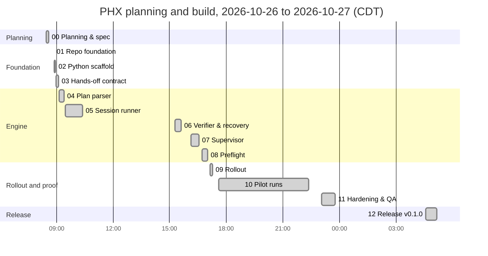

# PHX Final Report: PhaseHypervisor v0.1.0

**Written:** 2026-10-27 04:39 CDT (Phase 12). **Release:** v0.1.0, private repo `antonizick/PhaseHypervisor`. **Sign-off:** MVP complete; the Definition of done in `PHX_IMPLEMENTATION_PLAN.md` is fully checked, with the evidence in §2.

## 1. What was built

PhaseHypervisor (`phx`) runs a repo's phased-project plan hands-off. It reads `<PREFIX>_IMPLEMENTATION_PLAN.md` from `main`, asks Nick the foreseeable questions once, then starts one fresh headless Claude Code session per phase (`ai-provider run -p "/phase NN --auto"`) on the model the plan names. It verifies each phase itself, waits out usage limits and resumes. The supervisor never calls an LLM; the only model turns it spends are one-turn `haiku` probes and triage summaries.

| Part | Module(s) | Phase |
|---|---|---|
| Governance, scaffold, CI | repo files, `pyproject.toml`, `.github/` | 01, 02 |
| Hands-off `/phase` contract v1 (`--auto`, block-with-question, `PHX-RESULT`, Gate, lock check) | `docs/PHX_AUTO_MODE_CONTRACT.md`, skill templates | 03 |
| Plan parser, eligibility, drift | `plan.py` | 04 |
| Session runner, exit classifier (usage limits included) | `runner.py`, `classify.py` | 05 |
| Independent verifier, recovery table, triage | `verify.py`, `recover.py`, `triage.py` | 06 |
| Supervisor, locks, state, notifications, detach, vault summary | `supervisor.py`, `locks.py`, `state.py`, `notify.py`, `detach.py`, `vault.py` | 07 |
| Preflight question sweep | `preflight.py`, `prompts/PHX_preflight.md` | 08 |
| Rollout to MM3, CL, OCC, YTPL2; `/phx` command | other repos, `~/.claude/commands/phx.md` | 09 |
| Pilots and tuning | `docs/PHX_PILOT_REPORT.md` | 10 |
| Threat model, failure injection, fail-closed step 0 | `docs/PHX_THREAT_MODEL.md`, `tests/test_failure_injection.py` | 11 |
| Release | this report, version, tag | 12 |

**Size at release:** 7,126 lines under `src/phx/` (19 modules, standard library only), 491 tests passing plus 1 skipped (`PHX_AUDIT_DIR` unset), 95 % branch coverage (100 % on `plan.py`, `classify.py`, `recover.py`), 21 ADRs, spec amendments R14 to R22, 20 rated threats. The CLI is `phx preflight | run | resume | status | stop | log | answer | plan`.

## 2. Definition of done: evidence

| Item | Evidence |
|---|---|
| `phx preflight <repo>` asks the foreseeable questions once and records them | Real preflights on PXP and YTPL2 (Pilot report §2): Gates set, answers recorded as `Decided <TS>: … (phx preflight)`, records `8d848cb` and `6337d68`. MM3 acceptance in `test_mm3_acceptance_publication_caught` |
| `phx run` runs every remaining `auto` phase serially on its listed model with no human input, verified independently | PXP 01, 02, 03, 05, 07–09 on haiku and sonnet and YTPL2 03 on opus, each verified by PHX (status, merge, worktree, Phase Log, tests in a clean clone). `test_supervisor.py` happy path (3 phases, models haiku/haiku/sonnet) |
| Resumes a plan underway, including a `🔄` phase | PXP 09 (`phx stop` then `phx resume`, same session); manual → PHX → manual handover on PXP; `test_supervisor.py` (`resume_recorded`, `🔄` without a session) |
| A blocked phase records its question, notifies, continues after `phx answer` + `phx resume` | PXP 07 (agent-raised block, haiku triage summary, resumed and completed); `test_supervisor.py` block → answer → resume |
| Usage limit detected, logged, waited out, same session resumed; OpenRouter toggle resumes at once | Real session ended by a `PATH` shim printing the fixture's limit text: classified `usage_limit`, 308.6 s wait, 2 provider checks, 1 probe, same session resumed (PXP 08). Toggle: `test_supervisor.py` (no probe, resumed within 1,000 s). **Not seen live:** a real Pro limit or a real provider toggle (ADR-0009 stands on captured text and the 2.1.310 binary) |
| Supervisor costs zero tokens; per-phase totals logged; triage uses haiku only on failures | `session_end` events carry tokens and cost; verification and waits spend none; triage ran on the PXP 07 block (14,195 tokens on YTPL2's verification pause, $0.0027). Probe and triage are logged in their own events but not yet added to the run totals (limitation L3) |
| `run.jsonl` explains every decision; secrets redacted (tested) | Every `select`, `decision`, `wait_*` and `run_end` event carries a rule and reason (asserted per decision-table row). Redaction tests plus the audit of all Phase 10 state: 26 files, 2,081 lines, clean |
| `--detach` survives closing the terminal; `phx stop` stops cleanly | Manual check 2026-10-26 16:33 CDT (unit survived the launching shell, stop in about 1 s, resume continued the session); real `phx stop` on PXP 05 and 09 (exit 4, `🔄` kept); `test_cli_detach.py` |
| Skill templates, playbook and MM3/CL/OCC/YTPL2 carry the contract and ADR-0004 rules | Phase 09 commits MM3 `ba51654`, CL `dec549e`, OCC `2e0a7d4`, YTPL2 `2935948`; Phase 11 fail-closed step 0 in all five repos; `phx plan` reports `Contract: 1` for each |
| Auto mode off: `/phased-project`, `/phase`, `/phase-add` unchanged; manual → PHX → manual works | Phase 03 template diff (only step 0 added, steps 1–7 byte-identical); PXP handover 03 (PHX) → 04 (manual) → 05 (PHX, then manual) → 06 (manual) |
| Tests, lint, types pass in CI; repo pushed to a private GitHub repo | `uv run pytest` 491 passed, 1 skipped; ruff check and format, `mypy --strict src` clean; CI on `main` (Python 3.12 and 3.14), see Phase 12 Phase Log for the run on the tagged commit; `gh repo view antonizick/PhaseHypervisor` visibility `PRIVATE` |

## 3. Measured results (from the pilots)

Full tables: `docs/PHX_PILOT_REPORT.md`. Every number was measured; the one extrapolation is labelled.

| Measure | Result |
|---|---|
| Tiny haiku phase (PXP 01, 02) | 65–68 s, 0.5–0.7 M tokens (almost all cache reads), about $0.02 |
| Same-sized sonnet phase (PXP 03) | 35 s, $0.244 (11× the haiku cost) |
| Block + wait + stop (PXP 07–09, one run plus one resume) | 1,588,923 tokens, $0.0476 reported cost |
| Usage-limit wait (shim) | 308.6 s = reset + 2 min, 2 provider checks, 1 probe, same session resumed |
| Real phase of a real project (YTPL2 03, opus) | 1,141 s (19 min), 76 turns, 10.77 M tokens (97 % cache reads), $6.12, merged `a3f9bfe`, 199 tests and 99.5 % domain coverage delivered |
| Preflights (interactive opus) | PXP: 9 messages, about 1 minute; YTPL2 phases 03–13: 21 messages, 8 minutes including Nick's answers; neither records a cost (Claude Code writes none for interactive sessions) |
| Hands-off vs manual, same task | similar wall time and output; hands-off used ½ to ⅓ of the cache reads |
| Extrapolation (labelled) | the other eleven YTPL2 phases at the same size would cost about 11 × $6.12 ≈ $67 |

What the pilots found and fixed (F1–F9, Pilot report §3): false live-session pauses (ADR-0019), cut-off sessions recording 0 tokens, unhelpful gate and pause messages, step 0 failing open (fixed in Phase 11, ADR-0020), a foreground `phx run` dying with its Claude session (always `--detach` now), and a verification clone with no installed dependencies (YTPL2 `546f4b3`, plus a dry-run check from Phase 11).

## 4. Known limitations

Accepted residual risks (threat model §3) and deferred follow-ups, so nobody finds them by surprise.

### Accepted residual risks
| # | Risk | Why it stays |
|---|---|---|
| T1 | **Bypassed permissions.** A phase agent can run any command as Nick | Inherent to unattended phases (ADR-0003). Bounded by S1 (repos under `$PHX_WORK_ROOT`, never root), the risk-stop rule in each repo's `CLAUDE.md` (block-with-question in auto mode), S5 (never public, release or force-push), Gates and independent verification. Held at M |
| T2 | **Prompt injection** through repo text, plan rows or tool output | Same as T1. A forged `PHX-RESULT` cannot complete a phase whose row, merge, Phase Log or tests disagree. Held at M |
| T7 | **Secrets in logs.** Redaction is pattern-based | Covers `sk-or-`, `sk-ant-` (OAuth too), `gh[pousr]_`, `github_pat_`, bearer headers and `NAME=value` forms for `*TOKEN`, `*API_KEY`, `*SECRET`, `*PASSWORD`. A secret in an unrecognised shape would pass. Audited clean on all pilot state. Held at M |
| T19 | **A broken or malicious `ai-provider` on `PATH`** | Trusted by design: Nick's own script (spec R7). Held at M |

### Deferred follow-ups (none blocks the release)
| # | Item | Notes |
|---|---|---|
| L1 | Pilot cleanup | Nick decides when to delete `~/Work/tries/phx-pilot`, `~/Work/tries/phx-pilot-vault` and `~/.local/state/phx/phx-pilot`. PHX needs `PHX_VAULT_ROOT=~/Work/tries/phx-pilot-vault` to write that pilot's vault note |
| L2 | YTPL2 is left paused (`verification_failed`, already verified by hand) | `phx resume /home/nick/Work/YTPL2` would start its Phase 05 (04 is Gate `owner`) |
| L3 | Probe and triage cost are logged in their own events but not in the run totals | Accounting, not hardening |
| L4 | `phx status` shows the provider only after the first session of a run | Cosmetic |
| L5 | Detached runs stop at full logout (linger is `no`) | Nick's call; `loginctl enable-linger` is documented in the user guide |
| L6 | `--safe-mode` for probe and triage | Needs a token measurement on real sessions |
| L7 | Preflight lead patterns are tuned on MM3 and the sample plan | Needs more real preflights |
| L8 | CL has no `.phx/config.toml` `test_command` | CL is complete; only matters if CL is ever run hands-off |
| L9 | No real Pro usage limit or provider toggle has been observed | ADR-0009 stands on captured text and the 2.1.310 binary. Record the first real one |
| L10 | MM3, CL and OCC have no preflight record | Run `phx preflight` per repo before its first real run |
| L11 | The contract manual check's step 7 (a bypass-permissions `/phase next --auto` from a Claude session) was not run | The auto-mode classifier refused that launch in Phase 10; the same path is exercised by `phx run` itself |
| L12 | Prompt 01 spells the copyright holder "Nick Antoncic" | Historical; the licence uses the correct name |

## 5. Timeline: planning and build

All times CDT, from the Phase Log Timeline bullets and the claim commits on `main`. Phase 00 was the planning session (2026-10-26 08:27 to 08:35); phases 01–11 followed the same day; phase 12 ran after midnight.



Idle gaps: 10:23 to 15:16 (after Phase 05) and 23:46 to 04:34 (before Phase 12). No phase of this project was `⛔ Blocked`.

| Phase | Started | Finished | Duration | Claim commit |
|---|---|---|---:|---|
| 00 | 2026-10-26 08:27 | 08:35 | 8 min | n/a |
| 01 | 08:50 | 08:51 | 1 min | 792294d |
| 02 | 08:53 | 08:57 | 4 min | 462d097 |
| 03 | 08:58 | 09:06 | 8 min | a7d072b |
| 04 | 09:09 | 09:24 | 15 min | ee4491c |
| 05 | 09:27 | 10:23 | 56 min | 7ecc3a4 |
| 06 | 15:16 | 15:37 | 21 min | 81e5199 |
| 07 | 16:08 | 16:33 | 25 min | 38ca68a |
| 08 | 16:43 | 17:01 | 18 min | 6fa55bb |
| 09 | 17:08 | 17:17 | 9 min | 661c1bf |
| 10 | 17:35 | 22:22 | 4 h 47 min (real-token pilots, waits and Nick driving PXP phases 01–06) | 040388b |
| 11 | 23:03 | 23:46 | 43 min | 45f24e0 |
| 12 | 2026-10-27 04:34 | see the Phase 12 Phase Log entry | | 2d55bfb |

Total elapsed from the planning session to the end of Phase 11: 15 h 19 min (08:27 to 23:46), of which about 8 h 15 min was a phase running (Phase 10 alone is 4 h 47 min). The pilots exercised blocking on PXP 07 and a pause on YTPL2 03, both recorded in the Pilot report.

## 6. Using it day to day

```bash
phx preflight ~/Work/<repo>            # once per plan, in a terminal
phx run ~/Work/<repo> --dry-run        # what it would do, and the test command in a clean clone
phx run ~/Work/<repo> --detach         # hands-off, in the background
phx status ~/Work/<repo>               # where it is
phx answer ~/Work/<repo> <#> "<text>"  # after a block, then: phx resume ~/Work/<repo>
phx stop ~/Work/<repo>                 # clean stop; the phase stays resumable
```

Guide: `docs/PHX_USER_GUIDE.md`. Inside Claude Code: `/phx status|run|resume|preflight [repo]`. PHX stays optional (ADR-0011): `/phase` by hand works exactly as before.

## 7. What is next (Nick's call)

Making the repo public or creating a GitHub Release object were **not** done and need Nick's confirmation (CLAUDE.md, ADR-0004). Candidates after v0.1.0: L3 cost accounting, L6 `--safe-mode`, and recording the first real usage limit (L9).
