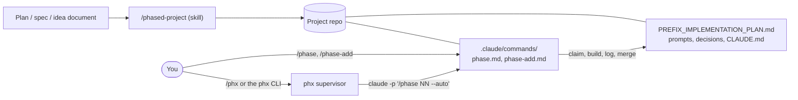

# Getting started with the phased-project method and PhaseHypervisor

This guide is for anyone who wants to use the method this repo was built with: plan a software build as numbered phases, run each phase in its own Claude Code session with `/phase`, and, optionally, let PhaseHypervisor (`phx`) run the remaining phases hands-off. You need none of the author's personal setup.

## 1. The pieces and how they fit

| Piece | What it is | Where it lives |
|---|---|---|
| **The method** | A way of working: one spec, one plan with a status table, one self-contained prompt per phase, a decision log, and fixed rules for claiming, finishing and logging a phase | Written into each project by the skill |
| **`/phased-project`** | A Claude Code skill. Give it a plan, spec or idea document and a target folder; it asks the decisions it needs, then writes the project's spec, plan, prompts, rules and commands | This repo's plugin (`plugins/phased-project/`), installed once per user |
| **`/phase`** | A per-project command, written by the skill into `.claude/commands/phase.md`. `/phase` runs the next eligible phase, `/phase NN` a given one, `/phase status` shows progress | Inside each project repo |
| **`/phase-add`** | A per-project command that plans a new lettered phase (`07a`) from a change request, without building it | Inside each project repo |
| **The plan and prompts** | `<PREFIX>_IMPLEMENTATION_PLAN.md` (phase table, status, owner questions, phase log), `prompts/<PREFIX>_phase-NN-*.md`, `prompts/<PREFIX>_shared-instructions.md`, `docs/<PREFIX>_DECISIONS.md`, `CLAUDE.md` | Inside each project repo |
| **`phx`** (optional) | PhaseHypervisor, a small Python program (no LLM calls of its own) that starts one headless `/phase NN --auto` session at a time, checks each phase itself, waits out usage limits and resumes | Installed with `uv tool install` |
| **`/phx`** (optional) | A command that drives `phx` from inside a Claude Code session | This repo's plugin |



The skill writes the project once. After that, everything runs from files in the repo: you can stop using the skill, uninstall `phx`, or switch between manual `/phase` and `phx` at any phase boundary.

## 2. Prerequisites
- **Linux** (supported). macOS is untested: the skill and commands should work, and `phx` runs, but `phx run --detach` needs `systemd-run --user` and desktop notifications need `notify-send`, so neither works there.
- **Claude Code**, signed in. Hands-off runs use your normal Claude Code login and plan limits.
- **git**, and optionally the GitHub CLI `gh` if you want agents to create GitHub repos.
- **[uv](https://docs.astral.sh/uv/)** and Python 3.12+, only for `phx`.

## 3. Install

### 3a. The skill and `/phx` as a plugin (recommended)
In a Claude Code session:
```text
/plugin install phased-project --marketplace antonizick/PhaseHypervisor
```
or from a shell: `claude plugin install phased-project --marketplace antonizick/PhaseHypervisor`. Restart Claude Code afterwards.

**Plugin names are namespaced.** Claude Code prefixes every plugin component with the plugin name, so as a plugin you type:

| Manual copy (3b) | Plugin (3a) |
|---|---|
| `/phased-project` | `/phased-project:phased-project` |
| `/phx` | `/phased-project:phx` |

The skill also triggers on its own when you ask for "a phased implementation plan". The commands it writes into each project, `/phase` and `/phase-add`, are project files and are **never** namespaced.

### 3b. Manual copy (no plugin)
```bash
git clone https://github.com/antonizick/PhaseHypervisor.git
mkdir -p ~/.claude/skills ~/.claude/commands
cp -r PhaseHypervisor/plugins/phased-project/skills/phased-project ~/.claude/skills/
cp PhaseHypervisor/plugins/phased-project/commands/phx.md ~/.claude/commands/
```
You get the short names `/phased-project` and `/phx`. Instead of copying you can symlink the two paths into your clone, so `git pull` updates them. Don't install both ways at once: you would see the skill twice.

### 3c. Optional settings and standing rules
Copy what you want from [`examples/CLAUDE.user.md`](../examples/CLAUDE.user.md) into your global `~/.claude/CLAUDE.md`. Every line is optional:
- **Phased-project settings**: your name (otherwise agents say "the owner"), your work folder, a notes vault for a per-project status note, a log for changes to your machine, and short project names for `/phx`. Without a vault, no vault note is written and the vault steps are skipped.
- **Standing rules**: timestamps from `date`, the project prefix, and the git authority rule (agents may commit, merge and push freely but must ask before making a repo public, publishing a release or force-pushing). Hands-off runs need that git rule. Delete it if you would rather approve every push, and tell `/phased-project` when you bootstrap.

### 3d. `phx` (optional, for hands-off runs)
```bash
uv tool install git+https://github.com/antonizick/PhaseHypervisor
phx --version
```
`phx` launches sessions with `claude` from your `PATH`. (If an `ai-provider` script is on your `PATH`, `phx` uses it instead; that is the author's provider switch and you don't need it.) By default `phx` only runs repos under `~/Work`; set `PHX_WORK_ROOT` to your own projects folder, for example `export PHX_WORK_ROOT=~/code` in your shell profile.

## 4. Your first project
1. **Bootstrap.** Write a plan or idea document (a page of Markdown is enough), open Claude Code on the strongest model, and run `/phased-project path/to/idea.md path/to/new-repo`. It asks for a project prefix (`MA` for "My App") and the decisions it cannot default, then writes the repo and makes the first commit.
2. **Look.** In the new repo, `/phase status` prints the phase table, what can run next and any open owner questions.
3. **Run a phase.** `/phase` picks the next eligible phase. If the phase names a different model, it tells you the `/model` command first. It claims the phase with a status-only commit on `main`, works in its own worktree `../<repo>-phase-NN`, runs the tests, writes the Phase Log entry and merges. Review the close-out summary, then start a fresh session for the next phase.
4. **Add work.** `/phase-add after 03 <what you want>` (or `/phase-add` alone, which interviews you) plans a new phase `03a`: its prompt, its row and any decisions. It builds nothing; you run it later with `/phase 03a`.
5. **Optionally go hands-off.** `phx plan <repo>` shows what `phx` sees. `phx preflight <repo>` opens one interactive session that asks every question it can foresee for the remaining phases. `phx run <repo> --dry-run` lists what would run, and `phx run <repo> --detach` runs it in the background (`phx status`, `phx log -f`, `phx stop`, `phx resume`). From inside Claude Code, `/phx status` and `/phx run` do the same with a confirmation step. Full reference: [PHX_USER_GUIDE.md](PHX_USER_GUIDE.md).

## 5. Safety model
- **Bypassed permissions only in hands-off runs.** Manual `/phase` uses whatever permission mode your session has. `phx` starts each phase session with `--permission-mode bypassPermissions`, so a hands-off phase can run any command as you. Use it only on repos and machines you trust, and read [SECURITY.md](../SECURITY.md) and the [threat model](PHX_THREAT_MODEL.md) first.
- **Risk rule.** Every generated `CLAUDE.md` tells agents to stop and ask before anything high-risk, irreversible or outside the phase's scope. In a hands-off run the agent cannot ask, so it **blocks** the phase instead: it records the question in the plan, and `phx` notifies you and pauses. Answer with `phx answer <repo> <#> "<answer>"`, then `phx resume <repo>`.
- **Gates.** Each phase has a Gate: `auto` (may run unattended), `review` (`phx` pauses after it so you can look) or `owner` (needs your hands; `phx` never starts it).
- **Always needs you:** making a repo public, publishing a release, force-pushing shared history, and anything the risk rule catches. Committing, merging and pushing do not, if you adopted the git authority rule.
- **What the plugin itself can do.** Installing it adds instructions only: one skill and one command, no hooks, no MCP servers, no executables. They act through Claude Code's normal tools and permission prompts.

## 6. Updating and uninstalling
- **Plugin:** `claude plugin update phased-project@phasehypervisor` (restart Claude Code), and `claude plugin uninstall phased-project@phasehypervisor` to remove it. `claude plugin marketplace remove phasehypervisor` forgets the marketplace.
- **Manual copy:** copy the two paths again from a fresh `git pull`, or delete `~/.claude/skills/phased-project` and `~/.claude/commands/phx.md`.
- **`phx`:** `uv tool upgrade phx` and `uv tool uninstall phx`. Run state is under `~/.local/state/phx/`; delete it if you no longer need the logs.
- **Projects keep working.** Each repo's `/phase` and `/phase-add` are its own files: updating or removing the plugin does not change them. To give an older project the newest command text, ask `/phased-project` to "migrate this repo" (its "Migrating to the hands-off contract" section).

## 7. Troubleshooting
- **`/phased-project` is not found**: as a plugin it is `/phased-project:phased-project`; after installing, restart Claude Code. `claude plugin list` shows whether it is enabled.
- **`/phase` is not found in a project**: start Claude Code in the repo's main folder (where `.claude/commands/phase.md` is), not in a parent folder.
- **`/phase` says the PHX check could not run**: step 0 needs `git`, `flock` and a shell; it fails closed on purpose. Install `util-linux` (for `flock`) or allow the command.
- **`phx` says the repo is outside `~/Work`**: set `PHX_WORK_ROOT` (section 3d).
- **`phx` says "repo not yet migrated"**: the project's `phase.md` has no `PHX-CONTRACT: 1` line; it predates hands-off mode. Migrate it as in section 6.
- **`phx run --detach` fails**: no `systemd-run --user` on this host. Run `phx run <repo>` in a terminal you keep open (for example inside `tmux`).
- **No notifications**: `notify-send` is missing or there is no display. `phx` logs that and carries on; `phx status` and `phx log` have everything.
- **The plan table looks wrong**: `phx plan <repo>` lists parse problems and drift (a branch without a claim, a claim without a branch).

## 8. What is optional
| Optional part | Without it |
|---|---|
| `phx` and `/phx` | Run every phase by hand with `/phase`; the method is complete without them |
| The settings section | Agents say "the owner"; no vault note; you give target folders by path |
| A notes vault | No vault note; the plan in the repo stays the source of truth |
| An OS-modifications log | Phases that change your machine just say so in their Phase Log |
| `ai-provider` | `phx` launches `claude` directly; you switch providers yourself |
| `notify-send` | No desktop notifications; check `phx status` |
| systemd (`--detach`) | Run `phx` in a terminal you keep open |
| `gh` | Agents commit and merge locally; you create the remote yourself |

## 9. Learn more
- [PHX_USER_GUIDE.md](PHX_USER_GUIDE.md): every `phx` command in detail.
- [PHX_AUTO_MODE_CONTRACT.md](PHX_AUTO_MODE_CONTRACT.md): exactly what `/phase NN --auto` promises `phx`.
- This repo is itself built with the method: read [PHX_IMPLEMENTATION_PLAN.md](../PHX_IMPLEMENTATION_PLAN.md) and [prompts/](../prompts/) for a complete worked example.
