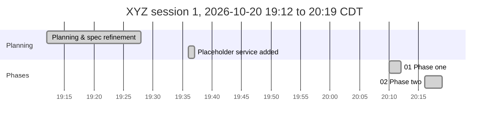
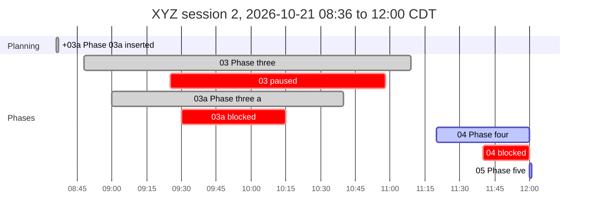

<!-- phase-timeline:start (generated by scripts/phase_timeline.py; do not edit) -->

*Generated from the Phase Log Timeline bullets and git, as of 2026-10-21 12:00 CDT. ≈ marks a time inferred from git or a heading. Idle gaps over 60 min start a new chart below and are collapsed in the image. Regenerate with `python3 scripts/phase_timeline.py --write`; do not edit by hand.*

| Phase | Name | Started | Finished | Merged | Active | Blocked | Claim |
|---|---|---|---|---|---:|---:|---|
| 00 | Planning & spec refinement | 2026-10-20 19:12 CDT | 19:28 |  | 16 m |  | n/a |
| plan | Placeholder service added | 2026-10-20 19:36 CDT | 19:37 |  | 1 m |  | n/a |
| +03a | Phase 03a inserted | 2026-10-21 08:36 CDT | 08:37 |  | 1 m |  | n/a |
| 01 | Phase one | 2026-10-20 20:10 CDT | 20:12 | 20:14 | 2 m |  | `1111111` |
| 02 | Phase two | 2026-10-20 20:16 CDT | 20:19 | 2026-10-21 04:22 CDT | 3 m |  | `2222222` |
| 03 | Phase three | 2026-10-21 08:48 CDT | 11:09 | 11:09 | 48 m | 1 h 33 m | `4444444` |
| 03a | Phase three a | 2026-10-21 09:00 CDT | 10:40 | 10:41 | 55 m | 45 m | `5555555` |
| 04 | Phase four | 2026-10-21 11:20 CDT | (blocked) |  | 20 m so far | 20 m | `6666666` |
| 05 | Phase five | 2026-10-21 12:00 CDT | (in progress) |  | < 1 m so far |  | `0fd481a` |

**Totals:** elapsed 16 h 48 m (first recorded start to 2026-10-21 12:00 CDT) · active phase time 2 h 8 m (sum over phases) · blocked or paused 2 h 38 m · idle 12 h 17 m in 1 gap(s) over 60 min.
<!-- phase-timeline:end -->
